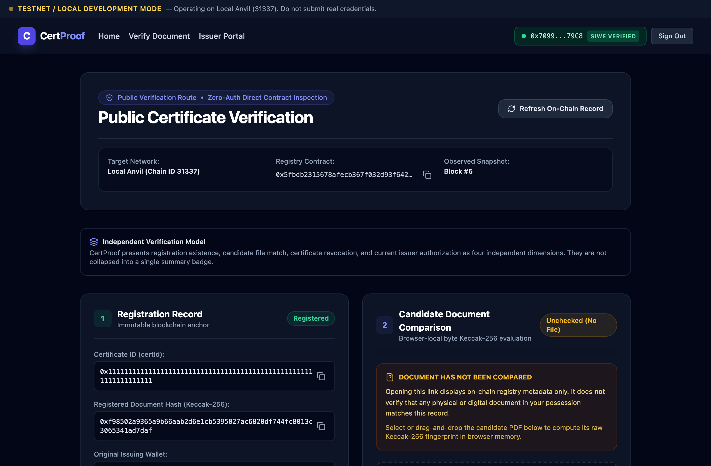
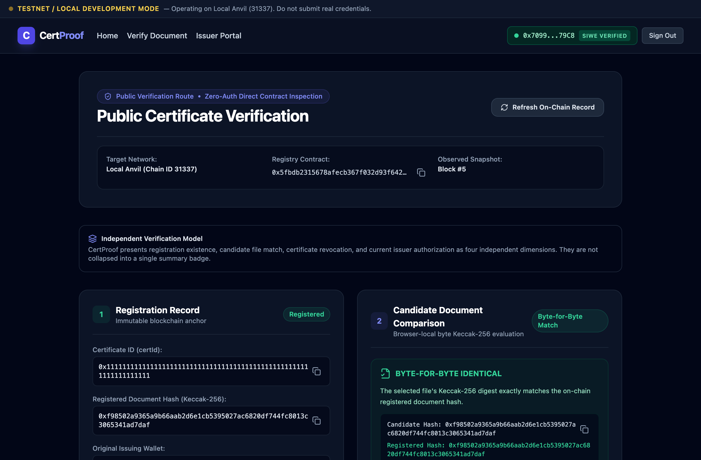
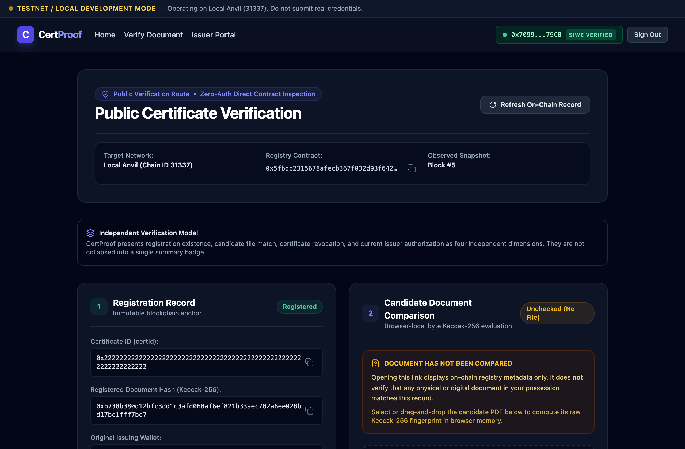
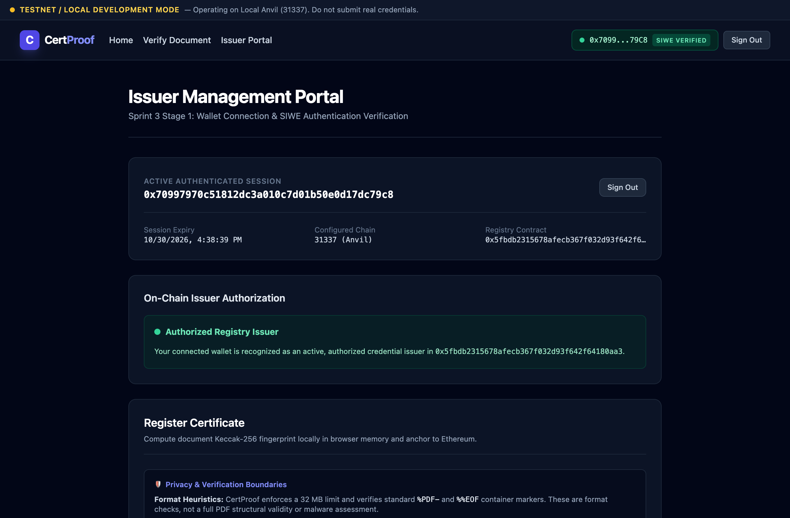

# CertProof — Decentralized Credential Verification

**Status:** Sprint 5, Stage 3 Complete (Unaudited Educational Prototype; Pending Interactive Wallet Acceptance; Sepolia Testnet Undeployed)  
**License:** [MIT](LICENSE)  
**Security Notice:** Unaudited Educational Prototype. Designed strictly for architectural study, testnets, and local development. Smart contracts have not undergone a third-party security audit. Ethereum mainnet deployment and real-asset transactions are strictly prohibited.

CertProof is a hybrid decentralized credential issuance and verification platform. It couples immutable EVM smart contracts (`CertProofRegistry.sol`) with privacy-preserving client-side document hashing in Web Workers and cryptographic session authentication (EIP-4361 Sign-In with Ethereum).

---

## 1. Problem Statement & Conceptual Model

### The Problem
Traditional academic and professional credential verification relies on either paper certificates with easily forged seals or centralized digital portals. Centralized verification creates severe vulnerabilities:
1. **Privacy Exposure:** Verifiers and employers upload sensitive personal documents (transcripts, degrees, medical certifications) to third-party verification servers.
2. **Single Points of Failure & Censorship:** Institutions lose records during infrastructure transitions, database corruptions, or operational closures.
3. **Silent Modification:** Centralized databases allow retroactive alterations or record deletions without cryptographic audit trails.

### The CertProof Solution
CertProof decouples **document privacy** from **integrity attestation**:
- **Zero Document Uploads:** Certificate PDFs are never transmitted across the network, stored in databases, or submitted to any blockchain mempool.
- **Client-Side Hashing:** Cryptographic fingerprints (`Keccak-256`) are computed strictly inside an isolated in-browser Web Worker.
- **On-Chain Attestation:** Authorized issuers register only immutable 32-byte digests and certificate identifiers on an EVM smart contract.
- **Instant Local Verification:** Verifiers drop candidate PDFs into their browser. The local hash is compared directly against the authoritative on-chain state.

### Meaning & Limits of a Hash Match
> [!IMPORTANT]
> - **What a Match Proves:** A green "BYTE-FOR-BYTE IDENTICAL" result proves with cryptographic certainty that the file held by the verifier matches the exact sequence of bytes signed by the issuer. Not a single character, whitespace, or byte has been altered.
> - **What a Match Does Not Prove:** A mathematical hash match does **not** evaluate whether the written statements inside the PDF are truthful or whether the issuer is legally accredited. Verification validity rests on the verifier trusting the on-chain issuer address and confirming its active authorization at the time of issuance.

---

## 2. Visual Walkthrough & Real Application Screenshots

The screenshots below were captured from an authentic local run in Google Chrome using synthetic test data:

### 2.1 Public Verifier — Initial Uncompared State
When navigating to `/verify/<certId>`, the verifier retrieves the authoritative on-chain record directly from Ethereum without requiring an injected wallet or user account. Prior to file selection, the interface prominently displays that the document has not yet been compared.



### 2.2 Public Verifier — Byte-for-Byte Matching PDF
When the candidate PDF is dropped into the verifier, a dedicated browser Web Worker computes the Keccak-256 hash locally. If the digest matches the on-chain record, an immutable verification receipt is displayed.



### 2.3 Public Verifier — Revoked Certificate Status
If an issuer revokes a credential, the contract permanently records the revocation block timestamp. Even if a candidate file matches the historical digest, the verifier warns that the credential has been permanently invalidated.



### 2.4 Issuer Dashboard — Issued Certificate History
Authenticated issuers manage issued credentials, review on-chain registration dates, trigger permanent revocations, and generate canonical verification QR share codes.



---

## 3. Architecture & Technology Stack

```
+───────────────────────────────────────────────────────────────────────────────────+
| Browser Client (Issuer / Verifier)                                                |
|  - Web Worker: In-browser Keccak-256 PDF hashing (zero file upload over network)  |
|  - Wagmi / Viem: Injected wallet connection & smart contract calls                |
|  - EIP-4361: Sign-In with Ethereum (SIWE) client flow                             |
|  - Zero-Wallet Verification: Public verify queries EVM smart contract directly    |
+───────────────────────────────────────────────────────────────────────────────────+
                                  │
                                  ▼
+───────────────────────────────────────────────────────────────────────────────────+
| Reverse Proxy Perimeter (Nginx / ALB / Cloudflare WAF)                            |
|  - Strips untrusted X-Forwarded-For / X-Real-IP headers                           |
|  - Injects verified TCP client remote address ($remote_addr)                      |
|  - Ingress rate limiting (default untrusted bucket: 'untrusted-client')           |
+───────────────────────────────────────────────────────────────────────────────────+
                                  │
                   ┌──────────────┴──────────────┐
                   ▼                             ▼
+──────────────────────────────────+   +────────────────────────────────────────────+
| CertProof Web App (Next.js 15)   |   | EVM Blockchain                             |
|  - Node.js 22 LTS Alpine runtime |   |  - Anvil (Local Testnet: Chain ID 31337)   |
|  - Non-root user `nextjs:1001`   |   |  - Sepolia (Staging: Chain ID 11155111)    |
|  - EIP-4361 SIWE challenge/auth  |   |  - Authoritative CertProofRegistry.sol     |
|  - Sealed HttpOnly session cookie|   |  - Immutable registration & revocation     |
|  - Public verify operates with   |   |  - Independent status fact separation      |
|    ZERO database dependency      |   |  - Two-step administrator ownership        |
+──────────────────────────────────+   +────────────────────────────────────────────+
                   │
                   ▼
+──────────────────────────────────+
| Document Store (MongoDB 7.0)     |
|  - Private container network     |
|  - Authenticated root user       |
|  - SIWE challenges & sessions    |
|  - Idempotent unique & TTL index |
|  - Named persistent volume       |
+──────────────────────────────────+
```

### Technology Highlights
- **Smart Contracts:** Solidity 0.8.24, Foundry (`forge`, `anvil`, `cast`), OpenZeppelin Contracts.
- **Frontend Framework:** Next.js 15.5 (App Router, Standalone Output), React 18, Tailwind CSS, TypeScript 5.6.
- **Web3 Layer:** Viem 2.x, Wagmi 3.x, EIP-4361 SIWE.
- **Storage & State:** Authenticated MongoDB 7.0 (session store only; zero documents), Browser `sessionStorage` (scoped pending operation recovery).
- **Packaging:** Multi-stage Dockerfile (`node:22-alpine`), Scoped Docker Compose orchestration.

---

## 4. Privacy Boundaries & Security Architecture

1. **Zero-Data Leak Rule:**  
   Raw PDF bytes never leave the client's device. Hashing executes in a dedicated Web Worker via `crypto.subtle` / Keccak-256. No file bytes or document contents are ever passed to API routes, stored in MongoDB, or written to sessionStorage.
2. **Crash & Refresh Recovery Hygiene:**  
   In-flight transaction drafts stored in `sessionStorage` (`certproof_pending_registration` / `certproof_pending_revocation`) are strictly limited to non-sensitive identifiers (`certId`, `documentHash`, `issuerAddress`, `chainId`, `registryAddress`, `txHash`). Recovery strictly matches active wallet address and active chain ID before rehydration.
3. **Database Independence for Verification:**  
   The public verifier route (`/verify/[certId]`) interacts exclusively with the public EVM blockchain. If MongoDB crashes or goes offline, public verification continues to operate without interruption.
4. **Independent On-Chain State Invariants:**  
   In `CertProofRegistry.sol`:
   - Admin authorization is decoupled from certificate ownership.
   - Deauthorizing an issuer prevents new registrations but preserves all past issued certificates.
   - Deauthorized issuers retain permanent authority to revoke certificates they personally issued.
   - Administrators cannot revoke certificates issued by authorized issuers.

---

## 5. Configuration & Environments

CertProof strictly separates build-time client variables from runtime server secrets.

### 5.1 Environment Overview

| Variable | Scope | Purpose | Local Anvil Default | Sepolia Staging Example |
| :--- | :--- | :--- | :--- | :--- |
| `NEXT_PUBLIC_APP_URL` | Build / Client | Origin URL for SIWE domain binding | `http://localhost:3010` | `https://certproof.example.com` |
| `NEXT_PUBLIC_CHAIN_ID` | Build / Client | Target EVM chain identifier | `31337` | `11155111` |
| `NEXT_PUBLIC_REGISTRY_ADDRESS` | Build / Client | Deployed contract address | `0x5fbdb2315678afecb367f032d93f642f64180aa3` | Undeployed / Custom |
| `NEXT_PUBLIC_ANVIL_RPC_URL` | Build / Client | Browser RPC endpoint for local Anvil | `http://127.0.0.1:8545` | N/A |
| `NEXT_PUBLIC_SEPOLIA_RPC_URL` | Build / Client | Browser RPC endpoint for Sepolia | N/A | `https://rpc.sepolia.org` |
| `MONGODB_URI` | Runtime / Server | Authenticated MongoDB connection | `mongodb://...` | Dedicated cluster URI |
| `SESSION_SECRET` | Runtime / Server | 32+ byte cryptographic session key | Local dev secret | Cryptographically secure random secret |
| `TRUST_PROXY` | Runtime / Server | Reverse proxy header trust | `false` | `true` |
| `SERVER_RPC_URL` | Runtime / Server | Container-internal RPC URL | `http://anvil:8545` | Authenticated Sepolia endpoint |
| `COOKIE_SECURE` | Runtime / Server | Enforces `Secure` cookie flag | `false` | `true` |

Reference environment configuration templates:
- Local development & Docker: [`frontend/.env.local.example`](frontend/.env.local.example)
- Sepolia testnet staging: [`frontend/.env.sepolia.example`](frontend/.env.sepolia.example)

### 5.2 Deployment Manifests
Authoritative deployment records are stored in `deployments/`:
- [`deployments/local-anvil.json`](deployments/local-anvil.json): Contains verified bytecode hash and address for local Anvil.
- [`deployments/sepolia.example.json`](deployments/sepolia.example.json): Template for testnet staging deployment.

To verify deployment manifest schema and on-chain bytecode integrity:
```bash
npm run verify:manifest deployments/local-anvil.json
```

---

## 6. Quick Start & Reproducible Execution

### 6.1 Prerequisites
- **Node.js**: v22 LTS (Node 22 "Jod" supported LTS; Node 20 reached End-of-Life on April 30, 2026; matches Docker runtime)
- **Foundry**: `forge`, `anvil`, `cast` (install via `foundryup`)
- **Docker Engine & Docker Compose**: v2+

### 6.2 Local Docker Orchestration

1. **Launch Full Stack (Web + MongoDB + Scoped Anvil):**
   ```bash
   docker compose --profile local-anvil up -d --build
   ```
   - Application: `http://127.0.0.1:3010`
   - Authenticated MongoDB: `127.0.0.1:27017`
   - Anvil RPC Node: `127.0.0.1:8545`

2. **Check Container Status & Logs:**
   ```bash
   docker compose ps
   docker compose logs -f web
   ```

3. **Shutdown & Persistent Data Preservation:**
   ```bash
   # Preserves MongoDB documents and Anvil chain state across restart
   docker compose stop
   # or
   docker compose down
   ```
   > [!NOTE]
   > Persistent named volumes (`mongo_data` and `anvil_data`) ensure that contract deployments, registered certificates, and user sessions survive normal restarts intact.

4. **Destructive Reset (Wipes all local state):**
   ```bash
   # Permanently deletes database and local blockchain state
   docker compose down -v
   ```

---

## 7. Verification & Test Evidence

CertProof maintains comprehensive automated test coverage across contract unit/fuzz/invariants, frontend integration, real-browser Playwright automation, and package smoke tests.

| Suite | Command | Scope & Assertions | Status |
| :--- | :--- | :--- | :---: |
| **Smart Contract Tests** | `npm run test` | 38 Foundry tests (33 unit tests, 4 fuzz tests, 1 stateful invariant suite with 2048 calls, 0 reverts) | **PASSED** |
| **Frontend Unit & Integration** | `npm run web:test` | 150 Vitest tests across 19 suites (SIWE, session lifecycle, recovery drafts, IP trust rate limiting) | **PASSED** |
| **Real Browser E2E** | `npm run test:browser` | 8-phase Playwright suite in real Google Chrome exercising Web Worker zero-upload hashing and QR modal | **PASSED** |
| **Isolated Anvil Persistence** | `npm run verify:anvil-persistence` | Verifies chain ID, contract bytecode, and synthetic certificate state survive container stop/restart | **PASSED** |
| **Package Container Smoke** | `npm run smoke:package` | 10-phase isolated Docker Compose smoke test verifying multi-stage build, indexes, static chunks, and outages | **PASSED** |
| **Deployment Manifest Check** | `npm run verify:manifest` | Validates manifest schema, chain ID, and on-chain runtime bytecode hashes | **PASSED** |
| **Type Check & Lint** | `npm run web:lint` | TypeScript compilation and ESLint static analysis (0 warnings, 0 errors) | **PASSED** |
| **Dependency Audits** | `npm audit` | Upstream package vulnerability inspection (0 vulnerabilities) | **PASSED** |

### Manual Acceptance Status
Interactive wallet extension acceptance procedures (testing authentic browser wallet extension popups, hardware keys, and manual signature rejections) are documented in [`docs/manual-wallet-acceptance.md`](docs/manual-wallet-acceptance.md) and remain marked **PENDING** operator execution.

---

## 8. Portfolio Demo Walkthrough

To execute a local end-to-end demonstration using pre-seeded test fixtures:

```bash
# 1. Compile smart contracts and export ABI
npm run compile
npm run export-abi

# 2. Run local Anvil lifecycle demonstration
npm run demo:local

# 3. Capture authentic portfolio screenshots
npm run portfolio:screenshots

# 4. Run full containerized package smoke test
npm run smoke:package
```
