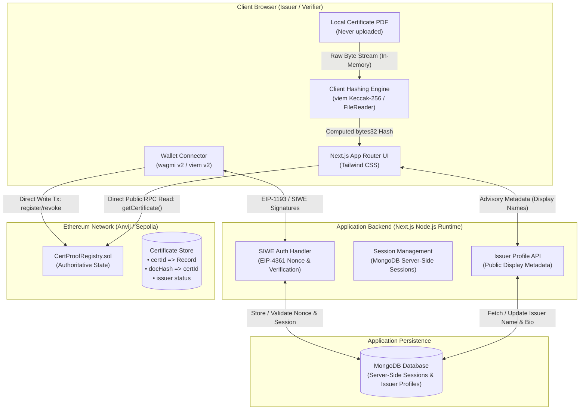
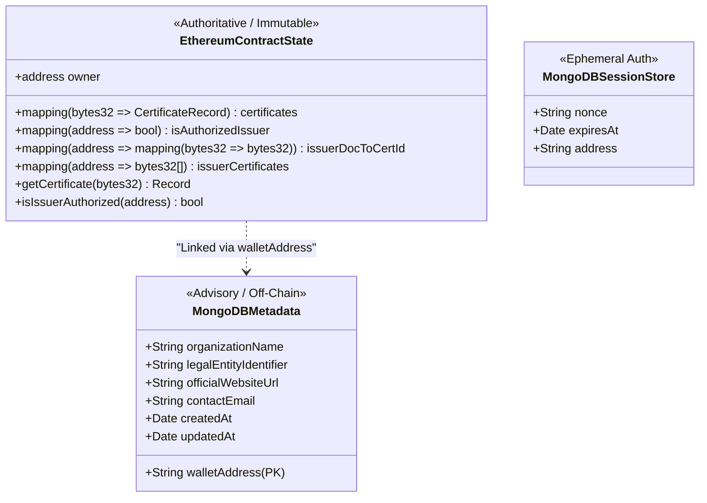

# CertProof — System Architecture (Sprint 1)

## 1. System Overview & Architecture Diagram

CertProof is architected as a decentralized, privacy-preserving credential verification system. The system strictly separates **authoritative consensus state** (Ethereum smart contracts) from **ephemeral client execution** (browser-based document hashing) and **advisory application metadata** (MongoDB).



---

## 2. Technology Stack & Rationale

| Component | Selected Technology | Version / Standard | Architectural Rationale |
| :--- | :--- | :--- | :--- |
| **Frontend Framework** | Next.js (App Router) | `^14.2.x` | Modern React Server Components (RSC) for optimized SEO on verification pages; lightweight client bundles for document inspection. |
| **Language** | TypeScript | `^5.4.x` | Strict typing across Solidity ABIs, hashing buffers, API requests, and UI state to prevent runtime bugs. |
| **Styling** | Tailwind CSS | `^3.4.x` | Utility-first styling enabling high-density dashboard layouts, clean verification statuses, and rapid UI iteration. |
| **Web3 Client** | wagmi & viem | `wagmi ^2.x`<br>`viem ^2.x` | Industry-standard lightweight EVM library with native TypeScript ABI inference, predictable RPC batching, and battle-tested wallet connectors. |
| **Authentication** | Sign-In with Ethereum (SIWE) | `EIP-4361`<br>`siwe ^2.x` | Cryptographic proof of wallet control without passwords or centralized OAuth providers; domain and nonce bound. |
| **Off-Chain Database** | MongoDB | `^6.0+` (Mongoose / Driver) | Schema flexibility for advisory issuer profiles (names, logos, URLs) and TTL-indexed SIWE session nonces. |
| **Smart Contracts** | Solidity | `^0.8.24` | Modern compiler with native overflow checks, custom error types (`revert CustomError()`) for gas efficiency, and transient storage awareness. |
| **Smart Contract Toolchain** | Foundry (Forge & Anvil) | Latest stable | High-speed compilation, native Solidity unit and fuzz testing, trace logging, and instant local EVM state fork via Anvil. |
| **Target Networks** | Local Anvil & Ethereum Sepolia | EVM | Standard Ethereum staging environment with public RPC redundancy and Etherscan verification. |

---

## 3. Direct Contract Reads vs. Indexer Architecture

A pivotal architectural decision for CertProof is whether to introduce a dedicated indexing layer (e.g., The Graph, Envio, Ponder) or rely on direct contract RPC reads.

### 3.1 Evaluation Matrix

| Criterion | Direct Contract RPC Reads (Selected for MVP) | Standalone Indexer (The Graph / Envio) |
| :--- | :--- | :--- |
| **Public Verification Trust** | **Absolute.** Zero intermediary cache. Verifier reads consensus state directly from the node. | Reduced. Verifier relies on indexer sync status and subgraph operator integrity. |
| **Infrastructure Overhead** | **Zero.** No indexer nodes to host, sync, prune, or pay query fees for. | High. Requires indexer deployment, schema maintenance, database hosting, and sync monitoring. |
| **Data Latency** | **Instant.** As soon as a block confirms, verification reads return the new state. | Lagged. Indexer block ingestion introduces 2–30 seconds of pipeline latency. |
| **Query Flexibility** | Limited to explicit contract getters (`getCertificate`, `getIssuerCertificates`). | High. Arbitrary filtering, sorting, full-text search, and relational aggregations. |
| **Suitability for CertProof MVP** | **Perfect.** Certificates are looked up by exact `certId`. Issuer dashboards are bounded. | Over-engineered for MVP scale. Deferred to post-MVP if cross-issuer search is needed. |

### 3.2 Bounded Dashboard Discovery Pattern

To eliminate the need for an indexer while avoiding unbounded on-chain gas costs or RPC log spam:
1. **Contract-Level Bounded Pagination:**
   The `CertProofRegistry` contract maintains an internal array of certificate IDs issued by each address:
   ```solidity
   mapping(address => bytes32[]) private _issuerCertificates;
   ```
   A read-only getter exposes bounded, paginated slices:
   ```solidity
   function getIssuerCertificates(
       address issuer,
       uint256 offset,
       uint256 limit
   ) external view returns (bytes32[] memory certIds, uint256 total);
   ```
   - Maximum `limit` is capped at `50` items per request to guarantee execution fits within node RPC gas/memory limits.
   - For an issuer with 500 certificates, fetching page 1 (offset 0, limit 20) requires a single, sub-50ms RPC call.
2. **Event Emission for Archive Completeness:**
   Every registration emits `CertificateRegistered(bytes32 indexed certId, address indexed issuer, bytes32 indexed documentHash, uint256 timestamp)`.
   If off-chain synchronization is desired in future phases, the full transaction history can be reconstructed purely from receipt logs without touching storage.

---

## 4. State Boundaries: Consensus vs. Advisory Metadata



### 4.1 Authoritative Blockchain State
The Ethereum blockchain is the single source of truth for:
- **Certificate Record Integrity:** `certId`, `documentHash`, `issuerAddress`, `registeredAt` (block timestamp), `revoked` (boolean), `revokedAt`.
- **Issuer Authorization Status:** Whether an Ethereum address is authorized to issue certificates under this registry.
- **Revocation State:** Permanent invalidation records.

### 4.2 Advisory MongoDB Metadata
MongoDB stores only optional, non-sensitive operational data:
- **Issuer Profiles:** Organization display name (e.g., "Pacific Institute of Technology"), external URL, contact email, and administrative notes.
- **SIWE Authentication Records:** Single-use nonces, session timestamps, and CSRF tokens.

> [!IMPORTANT]
> A discrepancy between MongoDB and Ethereum is always resolved in favor of Ethereum. If MongoDB is wiped or unavailable, public verification remains 100% functional because verification only requires reading `CertProofRegistry.sol`.

---

## 5. Off-Chain Data Models & API Specifications

### 5.1 MongoDB Schemas (Mongoose Definitions)

#### IssuerProfile Collection
```typescript
interface IIssuerProfile {
  walletAddress: string;       // Lowercase 0x-prefixed hex string (Unique Index)
  organizationName: string;    // Display name (Max 120 chars)
  websiteUrl?: string;         // Verified organizational domain (Optional)
  contactEmail?: string;       // Operational contact (Private, optional)
  description?: string;        // Short bio / mission (Max 500 chars)
  createdAt: Date;
  updatedAt: Date;
}
```

#### AuthSession Collection (MongoDB Server-Side Sessions)
```typescript
interface IAuthSession {
  sessionId: string;           // Cryptographically secure session identifier
  walletAddress: string;       // Lowercase 0x-prefixed address
  createdAt: Date;
  expiresAt: Date;             // TTL index: session expiration
}
```

#### AuthNonce Collection
```typescript
interface IAuthNonce {
  nonce: string;               // Cryptographically secure random alphanumeric string
  walletAddress?: string;      // Bound wallet address (if pre-specified)
  createdAt: Date;             // TTL index: expires in 5 minutes
}
```

### 5.2 Application API Endpoints

| Endpoint | Method | Auth Required | Purpose | Payload / Parameters | Response |
| :--- | :---: | :---: | :--- | :--- | :--- |
| `/api/auth/nonce` | `GET` | No | Generates an EIP-4361 compliant nonce. | None | `{ "nonce": "d82f7a9..." }` |
| `/api/auth/verify` | `POST` | No | Validates SIWE signature and sets session cookie. | `{ "message": "...", "signature": "0x..." }` | `{ "ok": true, "address": "0x..." }` |
| `/api/auth/session` | `GET` | Session Cookie | Returns current user session details. | None | `{ "authenticated": true, "address": "0x..." }` |
| `/api/auth/logout` | `POST` | Session Cookie | Destroys current session cookie. | None | `{ "ok": true }` |
| `/api/issuers/[address]` | `GET` | No (Public) | Retrieves advisory metadata for an issuer address. | URL param: `address` | `{ "organizationName": "...", "websiteUrl": "..." }` |
| `/api/issuers/profile` | `PUT` | Session (Issuer) | Updates profile metadata for authenticated issuer. | `{ "organizationName": "...", "websiteUrl": "..." }` | `{ "profile": { ... } }` |

---

## 6. RPC Strategy, Fallback & Failure Resilience

Public verification must remain accessible even during RPC node throttling, maintenance, or rate-limiting.

1. **RPC Provider Hierarchy:**
   - **Primary:** Dedicated node provider (e.g., Alchemy / Infura Sepolia endpoint via private server-side proxy).
   - **Secondary Fallback:** Public RPC endpoints (e.g., `https://rpc.sepolia.org`, Cloudflare Ethereum Gateway) configured in viem `fallback()` transport.
2. **Viem Multi-Transport Configuration:**
   ```typescript
   import { createPublicClient, fallback, http } from 'viem';
   import { sepolia } from 'viem/chains';

   export const publicClient = createPublicClient({
     chain: sepolia,
     transport: fallback([
       http(process.env.NEXT_PUBLIC_PRIMARY_RPC_URL, { retryCount: 2, timeout: 4_000 }),
       http('https://ethereum-sepolia-rpc.publicnode.com', { retryCount: 1, timeout: 6_000 }),
       http('https://rpc.sepolia.org', { retryCount: 1, timeout: 8_000 })
     ]),
   });
   ```
3. **Graceful Error Differentiation:**
   The verification UI explicitly distinguishes between:
   - A contract returning `zero` address for a certificate (Meaning: **Certificate does not exist on-chain**).
   - The RPC client throwing a transport or network error (Meaning: **RPC node unreachable / verification paused**). Under no circumstance is a network timeout interpreted as a missing or fake certificate.

---

## 7. Independent Verification Dimensions

Verification strictly decouples consensus and document states into four independent, non-conflated facts:
1. **Registration Existence:** Does a record exist on-chain for the given `certId`?
2. **File Hash Match:** Does the Keccak-256 hash of the presented file match the recorded `documentHash`? (Explicitly `UNCHECKED` until a candidate file is selected; opening a link without a file never implies the PDF was checked).
3. **Certificate Revocation:** Has the certificate been permanently revoked on-chain by the original issuer (`revoked == true`)?
4. **Current Issuer Authorization:** Is the original issuer currently authorized in the registry (`isIssuerAuthorized(record.issuer)`)?

Note that these dimensions are orthogonal: a certificate can be both revoked and issued by a currently deauthorized issuer.
