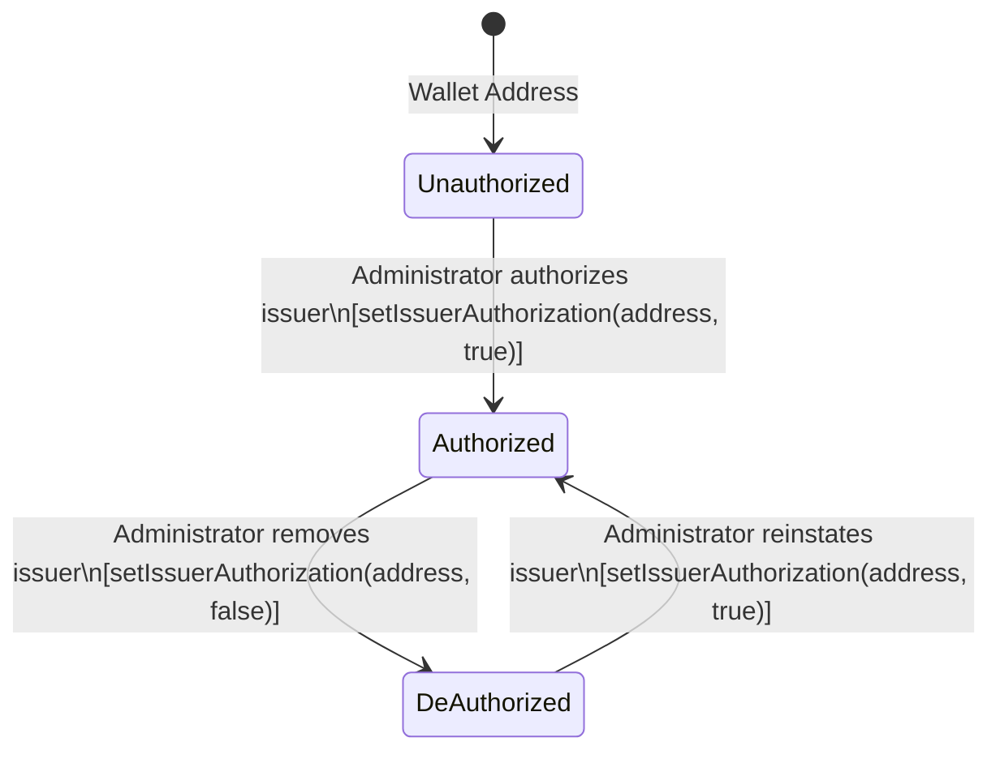
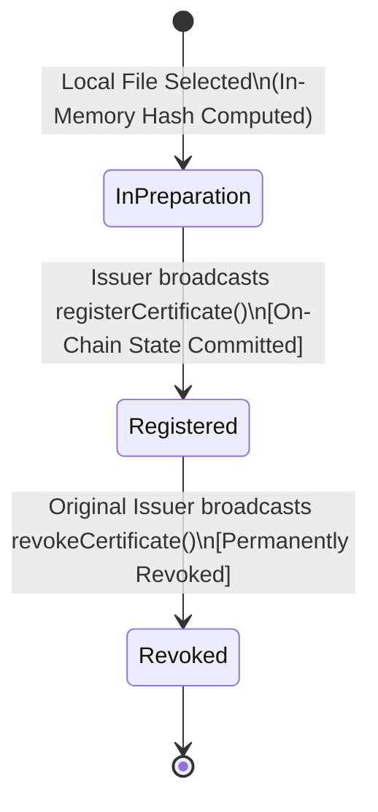

# CertProof — Certificate Identity & Issuer Model (Sprint 1)

## 1. Certificate Identity Specification

### 1.1 Opaque Certificate Identifiers (`certId`)
In CertProof, every certificate registration is referenced by an **opaque 256-bit identifier (`bytes32 certId`)**.

#### Design Requirements:
1. **Unpredictability & Privacy:** The `certId` must contain sufficient cryptographic entropy to prevent enumeration attacks, certificate harvesting, or brute-force crawling.
2. **Strict Disconnect from Student Identity:** Under **no circumstances** is a `certId` derived from student names, email addresses, student IDs, national identification numbers, grades, or sequential cohort rosters.
3. **Collision Resistance:** With 256 bits of cryptographic entropy, the probability of an identifier collision across the lifetime of the registry is negligible ($\approx 2^{-128}$).

#### Generation Algorithm (Client-Side Pre-Registration)
Before submitting a registration transaction, the browser client generates a cryptographically secure random salt:
```typescript
// 1. Generate 32 bytes of cryptographically secure random entropy
const salt = new Uint8Array(32);
window.crypto.getRandomValues(salt);

// 2. Derive certId using Keccak-256 across (issuerAddress, documentHash, salt)
import { keccak256, encodePacked } from 'viem';

const certId = keccak256(
  encodePacked(
    ['address', 'bytes32', 'bytes32'],
    [issuerAddress, documentHash, salt as `0x${string}`]
  )
);
```
- By committing the `issuerAddress` and `documentHash` into the hash pre-image alongside 256 bits of client entropy, the `certId` is cryptographically bound to that specific registration attempt while remaining completely opaque to outside observers.

---

## 2. Document Hashing Specification

To ensure exact parity between browser-side computation, smart contract storage, and subsequent verifier comparisons, CertProof defines a single, strict hashing specification.

### 2.1 Algorithm Selection: Keccak-256
- **Algorithm:** **Keccak-256** (FIPS 202 unpadded Keccak variant matching Ethereum standard opcode `0x20`).
- **Standard Output Representation:** 64-character lowercase hexadecimal string prefixed with `0x` (total string length: 66 characters), mapping directly to Solidity `bytes32`.
- **Rationale for Keccak-256 over SHA-256:**
  - Native alignment with the Ethereum virtual machine and EVM tooling (`viem`, `foundry`, `wagmi`).
  - Zero translation overhead when passing hashes between browser client buffers and smart contract call data.
  - Future-proofing for potential on-chain Merkle tree proofs, batch hash anchoring, or zk-proof integrations where Keccak-256 opcode execution costs 30 gas (compared to the SHA-256 precompile which costs 60 gas + 12 gas per word).

### 2.2 Raw Byte Stream Rule (Zero-Tamper Pipeline)
A primary failure of digital verification systems is normalizing or post-processing files before hashing. 

**CertProof enforces a Zero-Tamper Hashing Rule:**
1. **No Text Extraction:** The client does not parse PDF streams, extract text layers, or convert text to UTF-8.
2. **No Metadata Normalization:** Creation dates, author tags, and Producer metadata embedded in the PDF are **not** stripped or altered.
3. **No Compression or Re-serialization:** The file is ingested strictly as an uncompressed, unaltered binary `ArrayBuffer`.
4. **Byte-Level Determinism:** A one-bit modification—such as changing an invisible metadata tag, modifying an embedded font, or re-saving the PDF in Adobe Acrobat—produces a totally distinct Keccak-256 digest.

```typescript
/**
 * Computes the Keccak-256 digest of an unaltered binary file.
 * @param file Browser File object selected via <input type="file">
 * @returns bytes32 hex string (0x-prefixed, 64 hex characters)
 */
export async function computeDocumentHash(file: File): Promise<`0x${string}`> {
  const arrayBuffer = await file.arrayBuffer();
  const uint8Array = new Uint8Array(arrayBuffer);
  return keccak256(uint8Array);
}
```

### 2.3 File Acceptance & Safety Boundaries
To protect browser memory and prevent client UI freezing during drag-and-drop:
1. **Maximum File Size Limit:** **32 Megabytes (33,554,432 bytes)**. Files exceeding this limit are rejected by the browser client prior to buffer ingestion.
2. **PDF Format Heuristics:**
   - **Header Magic Bytes:** The file must begin with `%PDF-` (`0x25 0x50 0x44 0x46 0x2D`) at byte offset `0`.
   - **EOF Marker:** The file must contain the end-of-file trailer `%%EOF` within the final 1,024 bytes.
3. **Limitations of File Heuristics:**
   - Magic byte checks confirm that the file header matches standard PDF containers. They do **not** guarantee that the PDF is structurally valid, free of corrupted streams, or devoid of malicious embedded scripts.
   - However, because the client only reads the file as an inert binary array buffer and never executes or renders embedded scripts, PDF exploit vectors are neutralized during the hashing process.

---

## 3. Duplicate Registration Policy

CertProof balances institutional anti-collision requirements with multi-issuer flexibility.

### 3.1 Composite Uniqueness per Issuer
A single issuer cannot register the exact same document hash multiple times.
- **Contract Storage Mapping:**
  ```solidity
  mapping(address => mapping(bytes32 => bytes32)) private _issuerDocToCertId;
  ```
- **Rule:** If `_issuerDocToCertId[msg.sender][documentHash] != bytes32(0)`, the registration call reverts with `CertProof__AlreadyRegistered()`.

### 3.2 Independent Multi-Issuer Registration
- **Cross-Issuer Allowance:** If Issuer A registers Document Hash `H`, Issuer B (an independent authorized entity) is permitted to register Document Hash `H` under their own wallet and generate a new `certId`.
- **Rationale:** A dual-degree program, joint research certification, or multi-institution consortium may independently anchor the same joint PDF credential. CertProof maintains distinct provenance per issuer.

### 3.3 Permanent History for Revoked Certificates & Changed Files
- If Issuer A registers Document Hash `H` under Certificate ID `C1`, and later revokes `C1`, Issuer A **cannot** re-register Document Hash `H`.
- `_issuerDocToCertId[msg.sender][documentHash]` remains permanently bound to `C1` across the full lifecycle, including after revocation.
- This ensures that a revoked document cannot be silently recycled or re-activated by re-registering the same file bytes.
- **Changed Files Have Independent Hashes:** If an issuer modifies a document (e.g., updating a grade or correcting typographical errors), the resulting file produces an entirely distinct Keccak-256 digest `H2`. The issuer can register `(certId2, H2)` without collision because `H2 != H`.

---

## 4. Issuer Authorization & Revocation Lifecycle

### 4.1 Authorization Model
CertProof implements an explicit, minimal authorization registry managed by a designated contract owner (Administrator).



#### Separation of Original Issuer Identity and Current Authorization
A foundational principle in CertProof is the strict separation between:
1. **Immutable Historical Provenance (`certificate.issuer`):** The address recorded at registration time is permanent and immutable. It answers: *"Who originally issued this credential?"*
2. **Current Authorization Status (`isIssuerAuthorized(address)`):** Dynamic authorization managed by the registry administrator. It answers: *"Is this address currently authorized to act as an active issuer?"*

De-authorizing an issuer changes their current authorization status (`isIssuerAuthorized == false`), but **never erases or modifies** the `issuer` address recorded on historical certificates. Furthermore:
- A de-authorized issuer retains the right to revoke their previously issued certificates.
- De-authorization does not automatically revoke previous certificates.
- Re-authorization does not reactivate revoked certificates.
- A certificate can simultaneously be revoked (`revoked == true`) and issued by a currently de-authorized issuer (`isIssuerAuthorized(record.issuer) == false`).
1. **Administrator (`owner`):**
   - Can grant issuer authorization: `setIssuerAuthorization(address issuer, true)`.
   - Can revoke issuer authorization: `setIssuerAuthorization(address issuer, false)`.
   - Can transfer administration rights via a secure two-step transfer process.
   - **Cannot:** Register certificates on behalf of an issuer.
   - **Cannot:** Alter or overwrite existing certificate hashes.
   - **Cannot:** Revoke an issuer's certificate on their behalf.
2. **Authorized Issuer:**
   - Can call `registerCertificate(bytes32 certId, bytes32 documentHash)`.
   - Can call `revokeCertificate(bytes32 certId)` on certificates they originally issued.
3. **De-Authorized (Removed) Issuer:**
   - **Cannot** register new certificates (calls revert with `CertProof__UnauthorizedIssuer()`).
   - **Can still revoke their previously issued certificates** (calls to `revokeCertificate` succeed if `msg.sender == certificate.issuer`).

---

## 5. Certificate Lifecycle State Machine



### 5.1 On-Chain Data Structures

```solidity
struct CertificateRecord {
    bytes32 certId;          // Unique opaque identifier
    bytes32 documentHash;    // Keccak-256 of raw PDF bytes
    address issuer;          // Wallet address of the original issuer
    uint64 registeredAt;     // Block timestamp of registration
    uint64 revokedAt;        // Block timestamp of revocation (0 if active)
    bool revoked;            // Revocation flag
}
```

### 5.2 Contract State & Permission Matrix

| Operation | Registry Admin | Original Issuer (Authorized) | Original Issuer (De-Authorized) | Other Authorized Issuer | Unauthenticated Public |
| :--- | :---: | :---: | :---: | :---: | :---: |
| `setIssuerAuthorization` | **Allowed** | Denied | Denied | Denied | Denied |
| `registerCertificate` | Denied* | **Allowed** | Denied | **Allowed** | Denied |
| `revokeCertificate` | Denied | **Allowed** | **Allowed** | Denied | Denied |
| `getCertificate` (Read) | **Allowed** | **Allowed** | **Allowed** | **Allowed** | **Allowed** |
| `isIssuerAuthorized` (Read) | **Allowed** | **Allowed** | **Allowed** | **Allowed** | **Allowed** |

*\* Unless the administrator explicitly authorizes their own wallet address as an issuer.*

---

## 6. Ownership & Administrative Governance

To protect the decentralized trust properties of the registry:
1. **Initial Administrator Initialization:**
   The `CertProofRegistry` contract constructor accepts an explicit `initialOwner` address (`initialOwner != address(0)`).
   - The initial administrator is solely an administrator and **does not automatically receive issuer authorization**.
   - If the administrator intends to register certificates, it must explicitly authorize its own wallet via `setIssuerAuthorization(adminAddress, true)`.
2. **Two-Step Ownership Transfer:**
   Contract administration follows OpenZeppelin's `Ownable2Step` pattern:
   - Step 1: Current owner initiates transfer: `transferOwnership(address newOwner)`.
   - Step 2: Nominated pending owner confirms acceptance: `acceptOwnership()`.
   This eliminates accidental transfer to an invalid or zero address.
3. **Ownership Renunciation Disabled:**
   To prevent accidental or malicious permanent abandonment of the registry without an administrator to manage issuers, `renounceOwnership()` is explicitly overridden to revert with `CertProof__RenounceOwnershipDisabled()`. Administrative control can only be transitioned via the two-step transfer process.
4. **Immutable Certificate Records:**
   The registry contract intentionally omits any `updateCertificate`, `replaceHash`, or `transferCertificate` functions. Once written, a certificate's hash, issuer address, and registration timestamp can never be modified.
5. **Revocation is Unidirectional:**
   There is no `unrevokeCertificate` or reactivation function. A revoked certificate is permanently invalidated.

---

## 7. Independent Verification Dimensions

Verification exposes four independent, non-conflated facts:
1. **Registration Existence:** Whether a certificate record exists for the given `certId` (non-zero `registeredAt`).
2. **File Hash Match:** Whether candidate file bytes match the recorded `documentHash`. Opening a verification link without selecting a file exposes metadata but explicitly designates file hash status as `UNCHECKED`, never implying the PDF was checked or authentic.
3. **Certificate Revocation:** Whether the certificate was revoked by the original issuer (`revoked == true`).
4. **Current Issuer Authorization:** Whether the original issuer is currently authorized (`isIssuerAuthorized(record.issuer) == true`).

These states are completely orthogonal:
- A certificate can be both revoked and issued by a currently de-authorized issuer.
- De-authorization of an issuer does not alter revocation status.
- Re-authorizing an issuer does not reactivate revoked certificates.

---

## 7. Security Incident Response: Compromised Issuer Keys

A critical threat in decentralized public registries is the compromise of an authorized issuer's private key. CertProof's model defines explicit operational capabilities and boundaries:

### What the MVP Can Resolve:
1. **Immediate Quarantine:** The Registry Administrator calls `setIssuerAuthorization(compromisedAddress, false)`. From that block forward, the compromised key is incapable of creating new certificate registrations.
2. **Historical Status Display:** Public verification queries on certificates previously issued by the compromised key will immediately reflect `ISSUER_DEAUTHORIZED`. Verifiers are explicitly notified that the issuing entity's authorization has been terminated.
3. **Legitimate Invalidation:** If the legitimate institution still retains key access or an emergency recovery window exists, they can invoke `revokeCertificate` on any fraudulent credentials that were injected.

### What the MVP Cannot Resolve (Explicit Limitations):
1. **No Retrospective History Rewrite:** The administrator cannot unilaterally purge or rewrite historical registrations created by the compromised key prior to de-authorization.
2. **No On-Chain Arbitration Court:** The MVP does not feature off-chain dispute arbitration, DAO voting tribunals, or subjective adjudication mechanisms.
3. **Remediation Path:** When an issuer replaces a compromised key, the administrator authorizes the new institutional key. The institution then re-issues legitimate certificates under their new address and notifies recipients of their updated verification links.
