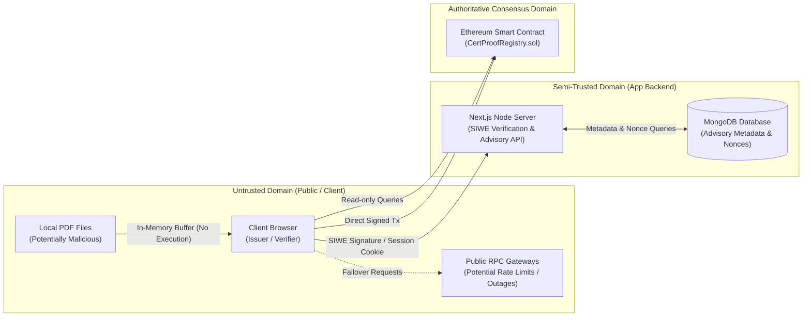

# CertProof — Security Model & Test Plan (Sprint 1)

## 1. Threat Model & Trust Boundaries



### 1.1 Trust Boundaries & Asset Classification
- **Smart Contract (`CertProofRegistry.sol`):** Authoritative root of trust. Must be completely self-protecting against unauthorized state changes, unauthorized revocations, front-running, and denial of service.
- **Client Browser:** Untrusted execution environment. Must protect user privacy by never sending raw certificate documents over the wire.
- **Application Server & Database:** Semi-trusted helper. Provides SIWE session management and advisory issuer metadata. A compromise of the database **must not compromise cryptographic verification integrity**.
- **Public RPC Endpoints:** Untrusted transport. May experience downtime or return stale blocks; the client must validate responses and handle transport errors gracefully.

---

## 2. Privacy Guarantees & Data Boundaries

### 2.1 The Zero-Knowledge Privacy Boundary
1. **Zero PDF Transmission:**
   - Under no circumstances does the web application transmit PDF bytes, base64 strings, or file slices to `/api/*`, external cloud buckets, IPFS, or analytics endpoints.
   - All hashing takes place within an isolated browser `ArrayBuffer`. Memory references to the file buffer are dereferenced immediately following hash generation.
2. **No On-Chain PII:**
   - No student names, email addresses, graduation dates, grade point averages, or document URLs are written to the blockchain.
   - The on-chain footprint is strictly limited to:
     - `bytes32 certId` (Opaque random identifier).
     - `bytes32 documentHash` (Keccak-256 digest).
     - `address issuer` (EVM wallet address).
     - `uint64 registeredAt` / `uint64 revokedAt` (Unix timestamps).
     - `bool revoked` (Status flag).
3. **Information Disclosure Realities (What is Public):**
   - **Hash Matching:** A hash is a one-way digest, not encryption. If an external party already possesses a candidate document, they can compute its Keccak-256 hash and query the registry to check whether that exact document was issued by a given address.
   - **Link Sharing:** Anyone who receives a verification link (`/verify/[certId]`) can view the issuing address and block timestamp associated with that certificate ID.
   - **QR Code Content:** QR codes generated by the application encode **strictly the verification URL** (e.g., `https://certproof.app/verify/0x...`) without query parameters, recipient metadata, or personal data.

---

## 3. Authentication & Session Security (SIWE / EIP-4361 — Scheduled for Sprint 3)

*Note: Authentication is deferred to Sprint 3. The specification below outlines the planned MongoDB server-side session architecture.*

To protect the issuer administration pipeline against impersonation, replay, and session hijacking:

1. **Atomic Nonce Consumption:**
   - Nonces generated via `/api/auth/nonce` are single-use alphanumeric strings with a 5-minute Time-To-Live (TTL).
   - Upon receipt of a signed SIWE message at `/api/auth/verify`, the server atomically verifies and deletes the nonce from the database in a single transaction (`findOneAndDelete`). A replay of the exact same message will immediately fail.
2. **Server-Side Session Store:**
   - Authenticated sessions are stored in MongoDB (`AuthSession` collection) with cryptographically random session tokens sent to the client via HTTP-only, secure cookies.
3. **Domain & URI Binding:**
   - The server validates that the SIWE message's `domain` and `uri` match the exact host header and origin of the deployed application, preventing cross-domain signature relay attacks.
4. **Account Switching Protection:**
   - If the issuer switches their active wallet in MetaMask to an address that does not match the active session, the client detects the mismatch via wagmi's `useAccount()` hook, invalidates local state, and prompts the user to re-authenticate or disconnect.

---

## 4. Smart Contract Security Requirements

The `CertProofRegistry` contract adheres to the following strict security invariants:

| Security Invariant | Requirement & Enforcement |
| :--- | :--- |
| **Owner Boundary** | Only the registry administrator (`owner`) can authorize or de-authorize issuers via `setIssuerAuthorization`. |
| **Admin Self-Authorization** | The initial owner is not automatically an authorized issuer. To register certificates, the admin must explicitly authorize itself. |
| **Renunciation Protection** | Accidental or intentional ownership renunciation is disabled (`renounceOwnership()` reverts with `CertProof__RenounceOwnershipDisabled()`). Administration can only be changed via two-step transfer (`transferOwnership` + `acceptOwnership`). |
| **Issuance Boundary** | Only a currently authorized issuer (`isAuthorizedIssuer[msg.sender] == true`) can execute `registerCertificate`. |
| **Caller Derivation** | The issuer address is always strictly derived from `msg.sender`, never accepted as an input argument. |
| **Non-Zero Inputs** | `certId != bytes32(0)` and `documentHash != bytes32(0)` are strictly enforced upon registration. |
| **Global ID Uniqueness** | A `certId` can be registered at most once across the entire registry. Attempts to register an existing `certId` revert. |
| **Duplicate Prevention** | An issuer cannot register the same `documentHash` more than once, even if using a different `certId`. This prohibition is permanent and persists after revocation. |
| **Multi-Issuer Provenance** | Different authorized issuers may independently register the same document hash under distinct `certId`s. |
| **Revocation Sovereignty** | Only the original issuing wallet (`msg.sender == certificate.issuer`) can revoke a certificate. The registry admin **cannot** revoke certificates on behalf of an issuer. |
| **Post-De-authorization Revocation** | If an issuer is de-authorized by the administrator, their existing certificates remain intact, and the issuer **retains the ability to revoke** their historical certificates. |
| **Permanent Revocation** | A revoked certificate cannot be un-revoked or re-registered by the same issuer. Repeated calls to `revokeCertificate` revert clearly with `CertProof__AlreadyRevoked()`. |
| **Independence of States** | Current issuer authorization is completely independent of certificate revocation: a certificate can be both revoked and issued by a currently de-authorized issuer. De-authorization does not revoke previous certificates; re-authorization does not un-revoke. |
| **Immutability of Registered Data** | Once registered, `certId`, `documentHash`, `issuer`, and `registeredAt` can never be modified or overwritten. |
| **Zero-Address Guards** | Functions accepting addresses (`setIssuerAuthorization`, `transferOwnership`) revert if passed `address(0)`. |

---

## 5. Comprehensive Test Plan

Testing is structured across two primary test harnesses:
1. **Foundry Test Suite (Solidity):** Unit tests, fuzz testing, and formal invariant validation for smart contracts.
2. **Vitest & Playwright Suite (TypeScript / Next.js):** Client cryptographic parity, UI state edge cases, SIWE authentication security, and end-to-end browser flows.

### 5.1 Foundry Smart Contract Test Matrix

```solidity
// Contract Test Suite Outline (CertProofRegistry.t.sol)
contract CertProofRegistryTest is Test {
    // 1. Authorization Tests
    function test_AdminCanAuthorizeIssuer() public;
    function test_AdminCanDeauthorizeIssuer() public;
    function test_NonAdminCannotAuthorizeIssuer() public;
    function test_DeauthorizedIssuerCannotRegister() public;

    // 2. Registration Tests
    function test_AuthorizedIssuerCanRegister() public;
    function test_RevertIfDuplicateRegistrationSameIssuer() public;
    function test_DifferentIssuersCanRegisterSameDocHash() public;
    function test_RevertIfCertIdCollides() public;

    // 3. Revocation Tests
    function test_OriginalIssuerCanRevoke() public;
    function test_DeauthorizedIssuerCanStillRevokeOwnCert() public;
    function test_RevertIfNonIssuerAttemptsRevoke() public;
    function test_RevertIfAdminAttemptsRevoke() public;
    function test_RevertIfRevokingAlreadyRevokedCert() public;

    // 4. Invariant & Fuzz Tests
    function testFuzz_RegistrationStoresExactValues(bytes32 certId, bytes32 docHash) public;
    function testFuzz_PaginationBoundsNeverExceedArray(uint256 offset, uint256 limit) public;
}
```

### 5.2 Browser & Cryptographic Parity Fixtures

To ensure the client hashing engine generates outputs that match Foundry and Ethereum consensus bit-for-bit, concrete byte fixtures are defined:

#### Fixture 1: Standard Minimal PDF
- **File:** `fixtures/sample-certificate.pdf`
- **Byte Length:** `1,248 bytes`
- **Expected Keccak-256 Digest:** (Concrete vector validated in test suite).
- **Test:** Client `computeDocumentHash()` must output the exact same `bytes32` value as Foundry's `vm.readFileBinary()` piped to `keccak256()`.

#### Fixture 2: One-Byte Modification (Tamper Detection)
- **File:** `fixtures/sample-certificate-tampered.pdf`
- **Difference:** Single byte at offset `0x02A0` altered from `0x41` ('A') to `0x42` ('B').
- **Test:** Validates that `computeDocumentHash()` produces an entirely divergent hash, triggering `HASH_MISMATCH` in the verification UI.

### 5.3 Web & Integration Test Matrix

| Area | Test Identifier | Test Description & Assertion |
| :--- | :--- | :--- |
| **Hashing Engine** | `TEST-CRYPTO-01` | Browser computes Keccak-256 across a 25 MB file in $<800\text{ ms}$ without UI freeze. |
| **Hashing Engine** | `TEST-CRYPTO-02` | Reject non-PDF file lacking `%PDF-` magic header with explicit client error. |
| **SIWE Auth** | `TEST-AUTH-01` | Nonce cannot be reused across two consecutive `/api/auth/verify` calls. |
| **SIWE Auth** | `TEST-AUTH-02` | Signatures generated for a mismatched domain or expired timestamp are rejected. |
| **Public UI** | `TEST-VERIFY-01` | Visiting `/verify/[validId]` executes zero wallet prompts and returns valid record. |
| **Public UI** | `TEST-VERIFY-02` | Dragging matching PDF displays green authenticated badge; dragging altered PDF displays red mismatch. |
| **RPC Resilience** | `TEST-RPC-01` | Simulated RPC 500 error triggers `RPC_ERROR` notice without claiming certificate does not exist. |
| **State Recovery**| `TEST-TX-01` | Refreshing page during pending registration restores draft and awaits confirmed receipt. |
