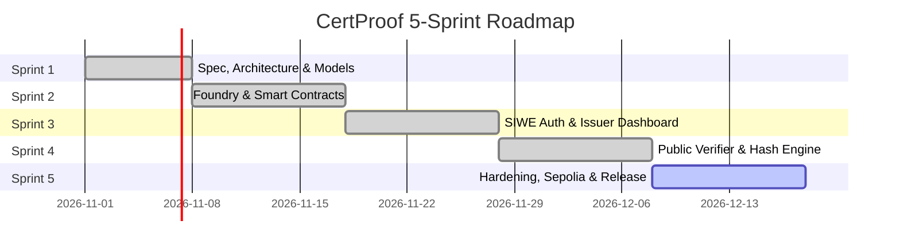

# CertProof — Implementation Roadmap & Sprint Backlog (Sprint 1)

## 1. Five-Sprint Roadmap Overview

The development of CertProof is structured across five sequential sprints. Engineering effort is estimated based on an individual developer working **15–20 focused hours per week**.

> [!NOTE]
> **Effort vs. Duration Separation:**
> Engineering effort represents active development and testing hours. Calendar duration reflects real-world elapsed time (including testnet gas faucet delays, RPC latency testing, security review buffers, and staging stabilization).

| Sprint | Focus Area | Engineering Effort | Projected Calendar Duration | Primary Deliverables |
| :---: | :--- | :---: | :---: | :--- |
| **Sprint 1** | **Specification & Architecture** *(Current)* | 18 hours | 1 calendar week | • Architecture, spec, threat model, user flows, and roadmap docs. |
| **Sprint 2** | **Core Smart Contracts & Foundry Pipeline** | 22 hours | 1.5 calendar weeks | • `CertProofRegistry.sol` • Full Foundry test suite (unit, fuzz, invariant) • Anvil deployment script & contract artifacts. |
| **Sprint 3** | **SIWE Authentication & Issuer Dashboard** | 24 hours | 1.5 calendar weeks | • Next.js app scaffold & Tailwind layout • SIWE EIP-4361 backend + MongoDB session/profile store • Issuer dashboard with bounded pagination. |
| **Sprint 4** | **Public Verification & Client Hash Engine** | 22 hours | 1.5 calendar weeks | • In-memory Keccak-256 PDF hashing module • Zero-auth public verification page (`/verify/[certId]`) • Local file comparison widget & QR code generator. |
| **Sprint 5** | **Hardening, Sepolia Deployment & Release** | 20 hours | 1.5 calendar weeks | • Sepolia testnet deployment & Etherscan verification • RPC fallback & edge state hardening • Documentation, open-source README, and demo video/guide. |
| **Total** | **Full MVP Lifecycle** | **106 hours** | **7 calendar weeks** | **Production-ready open-source portfolio MVP** |

---

## 2. Sprint 2: Ordered Task Backlog (Foundry & Smart Contracts)

Sprint 2 establishes the foundational consensus layer. No frontend code is developed until the contract interface, events, and test invariants are thoroughly proven in Foundry.

### Task 2.1: Foundry Project Initialization & Directory Scaffolding
- **Priority:** High (Blocker)
- **Estimated Effort:** 2 hours
- **Dependencies:** None
- **Acceptance Criteria:**
  - Standard Foundry project initialized in `contracts/`.
  - `foundry.toml` configured with Solidity version `0.8.24`, EVM target `cancun` (or `paris`/`shanghai` for broad compatibility), and remappings for OpenZeppelin Contracts.
  - OpenZeppelin Contracts v5 installed (`@openzeppelin/contracts`).

### Task 2.2: Implement `CertProofRegistry.sol`
- **Priority:** High
- **Estimated Effort:** 6 hours
- **Dependencies:** Task 2.1
- **Acceptance Criteria:**
  - Implements `Ownable2Step` for administrative control.
  - Implements `isAuthorizedIssuer(address)` mapping and `setIssuerAuthorization(address, bool)` with zero-address validation.
  - Implements `registerCertificate(bytes32 certId, bytes32 documentHash)`.
  - Implements composite deduplication via `_issuerDocToCertId[msg.sender][documentHash]`.
  - Implements `revokeCertificate(bytes32 certId)` enforcing `msg.sender == cert.issuer`.
  - Implements bounded getter: `getIssuerCertificates(address issuer, uint256 offset, uint256 limit)`.
  - Emits `CertificateRegistered`, `CertificateRevoked`, and `IssuerAuthorizationChanged` events.
  - Uses custom errors (e.g., `CertProof__UnauthorizedIssuer()`) for gas efficiency.

### Task 2.3: Comprehensive Foundry Unit & Access Control Tests
- **Priority:** High
- **Estimated Effort:** 6 hours
- **Dependencies:** Task 2.2
- **Acceptance Criteria:**
  - Test admin authorization and de-authorization of issuers.
  - Test authorized issuer successful registration.
  - Test duplicate registration reverts with `CertProof__AlreadyRegistered()`.
  - Test independent issuers registering identical document hashes succeed with separate IDs.
  - Test original issuer can revoke their certificate.
  - Test de-authorized issuer can still revoke their previously issued certificate.
  - Test non-issuer and admin cannot revoke someone else's certificate.
  - Test double-revocation reverts with `CertProof__AlreadyRevoked()`.

### Task 2.4: Invariant & Fuzz Testing
- **Priority:** Medium
- **Estimated Effort:** 4 hours
- **Dependencies:** Task 2.3
- **Acceptance Criteria:**
  - Fuzz test `certId` and `documentHash` inputs across arbitrary 32-byte sequences.
  - Fuzz test pagination bounds (`offset`, `limit`) verifying no out-of-bounds panics or array overflows occur.
  - Formal invariant: Registered hashes and original issuers never change across any series of contract transactions.

### Task 2.5: Local Anvil Deployment Script & Contract Artifact Export
- **Priority:** Medium
- **Estimated Effort:** 4 hours
- **Dependencies:** Task 2.2
- **Acceptance Criteria:**
  - Solidity deployment script (`script/DeployCertProofRegistry.s.sol`) written and tested against local Anvil node.
  - Automated task or script to export deployed address and generated TypeScript ABI definitions directly into the `frontend/` source tree.

---

## 3. Architecture Decisions & Constraints

| Category | Item Description | Concrete Decision / Resolution | Architectural Impact |
| :--- | :--- | :--- | :--- |
| **Resolved Decision** | **Solidity & EVM Target** | Pinned to Solidity `0.8.24` with EVM target `cancun`. | Matches active execution rules on Ethereum Mainnet, Sepolia, and local Anvil; standardizes gas semantics. |
| **Resolved Decision** | **Session Storage** | MongoDB server-side sessions (`AuthSession` collection) in Sprint 3. | Cryptographically strong server-side invalidation and session revocation support without client-side state risk. |
| **Resolved Decision** | **Ownership Renunciation** | `renounceOwnership()` is explicitly disabled. | Eliminates accidental loss of registry ownership; transfer requires two-step handshake. |
| **Resolved Decision** | **Admin Issuer Separation** | Admin must explicitly authorize itself to issue. | Clean separation between registry configuration governance and credential issuance provenance. |
| **Assumption** | **Zero PDF Storage** | Issuers and recipients store and transmit PDFs through their own existing channels. | Keeps architecture lightweight, eliminates legal/GDPR liabilities, and minimizes storage costs. |
| **Constraint** | **Browser Memory Limit** | Client-side in-memory hashing is capped at 32 MB per PDF. | Protects mobile and lower-end desktop devices from tab crashes; sufficient for 99.9% of certificate PDFs. |
