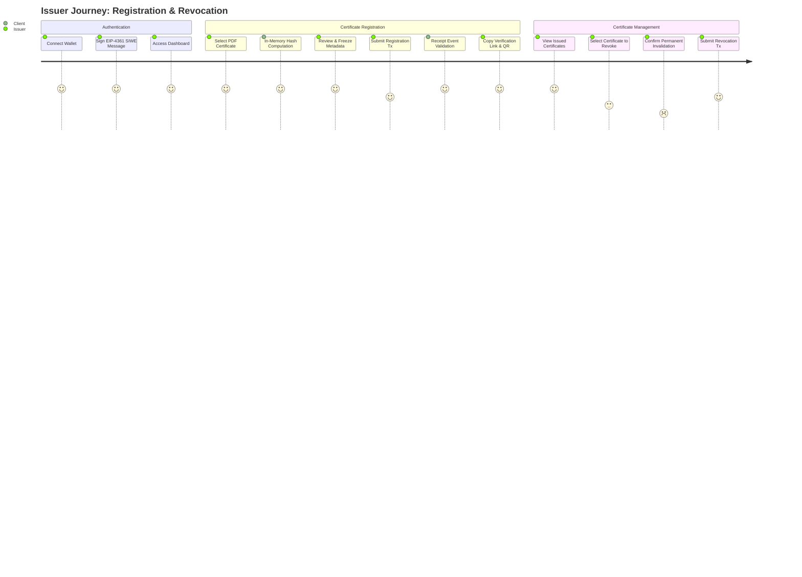
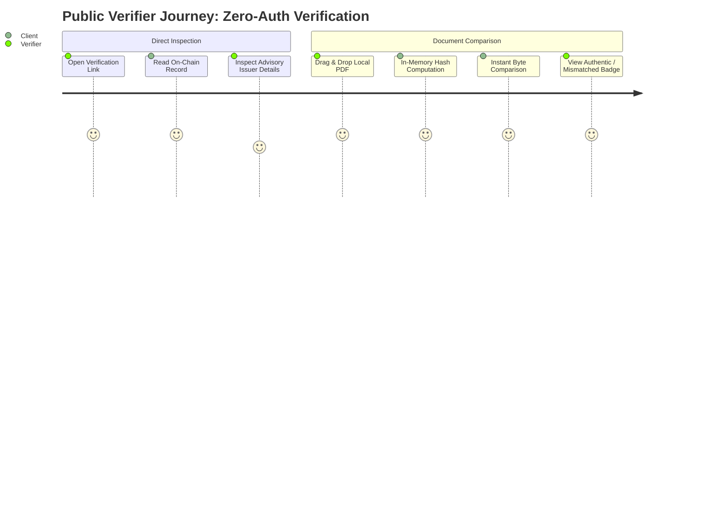

# CertProof — User Flows & Screen Specifications (Sprint 1)

## 1. End-to-End User Journeys

---

## 2. Screen Specifications & UI Component Design

### Screen 1: Landing & Issuer Sign-In (`/`)
- **Header:** Logo, Navigation ("Home", "Verify Document"), and "Connect Wallet" button.
- **Hero Section:** Clear value proposition: "Cryptographic Certificate Verification on Ethereum." Explicit disclaimer: *Verifies document byte equivalence without storing personal data.*
- **Action Modules:**
  - **Public Verification Quick-Access:** Input field to enter a 66-character Certificate ID (`bytes32`) directly.
  - **Issuer Access:** Prominent call to action for authorized institutions: "Issuer Sign-In".
- **SIWE Sign-In Modal:**
  - Triggered upon clicking "Sign In".
  - Shows connected address, network badge (Sepolia / Localhost), domain verification notice, and "Sign Authentication Message" button.
  - Displays progress spinner during wallet signature and server session establishment.

### Screen 2: Issuer Dashboard (`/dashboard`)
- **Access Guard:** Requires active SIWE session. If the connected wallet is not authorized on-chain, display an alert banner: *"Wallet 0x... is not an authorized issuer under this registry. Registration controls are disabled."*
- **Issuer Profile Card:**
  - Organization display name, wallet address with Etherscan link, and "Edit Advisory Metadata" modal button.
- **Primary Action:** "+ Register New Certificate" button.
- **Issued Certificates Table (Bounded Pagination):**
  - Columns:
    - **Certificate ID:** Truncated `0x1a2b...9f8e` with copy button.
    - **Document Hash:** Truncated `0xabcd...1234`.
    - **Registered Date:** Human-readable format + relative timestamp.
    - **Status:** Badge — `Active` (Green) or `Revoked` (Red).
    - **Actions:** "View Details", "Copy Link", "Revoke".
  - Pagination Controls: "Previous", "Page X of Y", "Next" (fetching bounded 20-item slices).

### Screen 3: PDF Registration & Confirmation (`/dashboard/register`)
- **Stage 1: File Selection & Parsing:**
  - Drag-and-drop zone accepting `.pdf` files.
  - Client validates file size ($\le 32\text{ MB}$) and magic bytes (`%PDF-`).
- **Stage 2: In-Memory Hash Review & Freeze:**
  - The client calculates the Keccak-256 hash immediately in browser memory.
  - UI displays a "Frozen Registration Summary" box:
    - File Name: `Graduation_Diploma_2026.pdf`
    - File Size: `1.42 MB (1,489,204 bytes)`
    - Document Hash: `0x7a3f89...` (Full 64-hex string)
    - Generated Certificate ID: `0xbc8921...`
  - Warning callout: *"Once submitted to Ethereum, this document hash cannot be edited. Ensure this is the exact, final document given to the recipient."*
  - Action Buttons: "Re-select Different File" or "Proceed to Blockchain Registration".
- **Stage 3: Transaction Broadcast & Event Extraction:**
  - Wallet prompts the issuer to sign `registerCertificate(certId, documentHash)`.
  - Transaction state tracker: `Preparing` $\rightarrow$ `Waiting for Signature` $\rightarrow$ `Broadcasting` $\rightarrow$ `Confirming (Block #)` $\rightarrow$ `Success`.
  - On receipt confirmation, the UI extracts `certId` from the `CertificateRegistered` event log.

### Screen 4: Registration Confirmation & Share Modal
- **Success Banner:** "Certificate Successfully Anchored to Ethereum".
- **Verification URL:** `https://certproof.app/verify/0xbc8921...` (Single-click copy button).
- **Embedded QR Code:** Vector-rendered QR code encoding the exact verification URL.
- **Action Buttons:** "Download QR Image (PNG)", "Open Verification Page", "Return to Dashboard".

### Screen 5: Registration Details & Revocation Modal
- **Certificate Detail View:** Displays on-chain block number, registration timestamp, issuer address, document hash, and revocation state.
- **Revocation Trigger:** Red "Permanently Revoke Certificate" button.
- **Destructive Action Modal:**
  - Heavy warning alert:
    > [!CAUTION]
    > **Revocation is permanent and irreversible.**
    > Once revoked on-chain, this certificate will permanently display as INVALID/REVOKED to any verifier. This action cannot be undone.
  - Requires explicit confirmation check: *"I understand this certificate will be permanently invalidated on Ethereum."*
  - Calls `revokeCertificate(certId)` via connected wallet.

### Screen 6: Public Verification Page (`/verify/[certId]`)
- **Header:** Zero-authentication public header.
- **Verification Dimensions Display:** Exposes four independent, decoupled facts:
  1. **Registration Record:** Registered block timestamp, original issuer address (linked to block explorer), and registered document hash.
  2. **File Byte Verification:**
     - Prior to file drop: Explicitly labeled **`UNCHECKED (No file selected)`** with an amber/neutral indicator. *Navigating to this page never implies the PDF was checked.*
     - After file drop: Computed in browser $\rightarrow$ **`MATCH (Byte-for-byte identical)`** (Green) or **`MISMATCH (Altered or wrong document)`** (Red).
  3. **Revocation State:** **`ACTIVE`** (Green) or **`REVOKED`** (Red, with permanent revocation timestamp).
  4. **Current Issuer Authorization:** **`AUTHORIZED`** (Green) or **`DEAUTHORIZED`** (Amber, indicating issuer authorization was removed by administrator).
- **Compound State Scenarios:** A certificate can be both **Revoked** and issued by a currently **Deauthorized** issuer; both statuses are rendered distinctly and independently.
- **Advisory Issuer Metadata:** Organization name from MongoDB displayed as advisory convenience with an explicit tooltip.
- **Document Comparison Widget (Drop Zone):**
  - Instructions: *"To verify document authenticity, select or drag and drop the candidate PDF here. File bytes are hashed locally in your browser memory and never uploaded to any server."*
  - Live Comparison Panel:
    - Registered Hash: `0x89ab...`
    - Local File Hash: `0x89ab...` (Matches! Green checkmark) or `0x1122...` (Mismatch! Red alert).

---

## 3. Failure & Edge State Handling Matrix

| Scenario / Error State | Trigger Condition | System Behavior & UI Presentation | Recovery Path |
| :--- | :--- | :--- | :--- |
| **Unknown Certificate** | Verifier visits `/verify/[certId]` where `certId` does not exist on-chain. | Displays `UNREGISTERED` banner: *"No record found for Certificate ID 0x... Ensure you copied the complete 66-character link."* | Verifier double-checks URL; no document comparison possible. |
| **Document Hash Mismatch** | Verifier drops a modified or different PDF against a valid `certId`. | Displays `HASH_MISMATCH` warning: *"Document Altered or Incorrect. The selected file's bytes do not match the on-chain registration."* Both hashes displayed side-by-side. | Verifier requests the original, unaltered digital original from the issuer. |
| **Revoked Certificate** | Verifier checks a valid document whose `certId` was revoked on-chain. | Displays `REVOKED` fact independently: *"Document Revoked. Although file bytes may match the registered hash, this certificate was permanently revoked by the issuing institution on [Date]."* | Informs verifier that credential is no longer recognized by issuer. |
| **Issuer De-Authorized** | Issuer wallet was removed by registry admin after certificate was issued. | Displays `DEAUTHORIZED` fact independently: *"Issuer Authorization Removed. The issuing address is no longer an authorized issuer in the registry."* | Verifier exercises discretion or contacts institution directly. |
| **Revoked and De-Authorized** | Certificate is revoked AND issuer wallet has been removed by admin. | Displays both `REVOKED` and `DEAUTHORIZED` independently, confirming both conditions are active. | Clear record that credential was revoked and issuer was de-authorized. |
| **RPC Node Outage / Timeout** | Ethereum RPC node fails to respond within 8 seconds or returns 5xx error. | Displays `RPC_ERROR` banner (Yellow): *"Verification Service Temporarily Unavailable. Unable to reach the Ethereum network. Please retry in a few moments."* | User clicks "Retry Connection". Node client switches to secondary fallback RPC. |
| **User Rejects Signature / Tx** | Issuer clicks "Reject" in MetaMask or hardware wallet. | Inline notification: *"Transaction cancelled by user. The document was not registered."* | Registration form remains intact with frozen hash ready to re-attempt broadcast. |
| **Wrong Network / Chain** | Connected wallet is on Ethereum Mainnet or Polygon instead of Sepolia. | Modal dialog with action: *"Wrong Network. CertProof operates on Sepolia Testnet. Click to switch network."* Uses `wallet_switchEthereumChain`. | Seamless 1-click network switch via wagmi. |
| **Page Refresh During Registration** | Issuer refreshes page after hash generation or while transaction is pending. | Form state restored from `sessionStorage` (cached draft salt, docHash, and pending txHash). | Detects pending tx via `useWaitForTransactionReceipt`. Prevents duplicate submission. |
| **Duplicate Registration Attempt** | Issuer attempts to register a PDF they previously anchored on-chain. | Contract reverts with `CertProof__AlreadyRegistered()`. Duplicate prohibition remains permanent even after revocation. (A modified file with a different hash can be registered). | Issuer is redirected to the existing certificate record. |
| **Oversized or Non-PDF File** | User selects a 45 MB file or a `.docx` file. | File picker instantly rejects input before reading: *"File exceeds 32 MB limit or does not have a valid PDF header (%PDF-)."* | User selects compliant PDF. |

---

## 4. Transaction Resilience & Refresh Recovery

To eliminate lost states or accidental duplicate broadcasts:
1. **Pre-Flight Freezing:** Once the document hash is computed, the tuple `(salt, certId, docHash, fileName, fileSize)` is saved to `window.sessionStorage.setItem('certproof_pending_draft', ...)`.
2. **Post-Broadcast Tracking:** Once the wallet signs and submits the transaction, the resulting transaction hash (`txHash`) is appended to the draft in `sessionStorage`.
3. **Idempotent Restoration:** If the user accidentally refreshes the browser while the transaction is mining:
   - On page reload, the client inspects `sessionStorage`.
   - If a pending `txHash` exists, it invokes `waitForTransactionReceipt({ hash: txHash })` instead of prompting the user to broadcast a second transaction.
   - Once confirmed, receipt logs are parsed to display the confirmed certificate, and `sessionStorage` is cleared.
